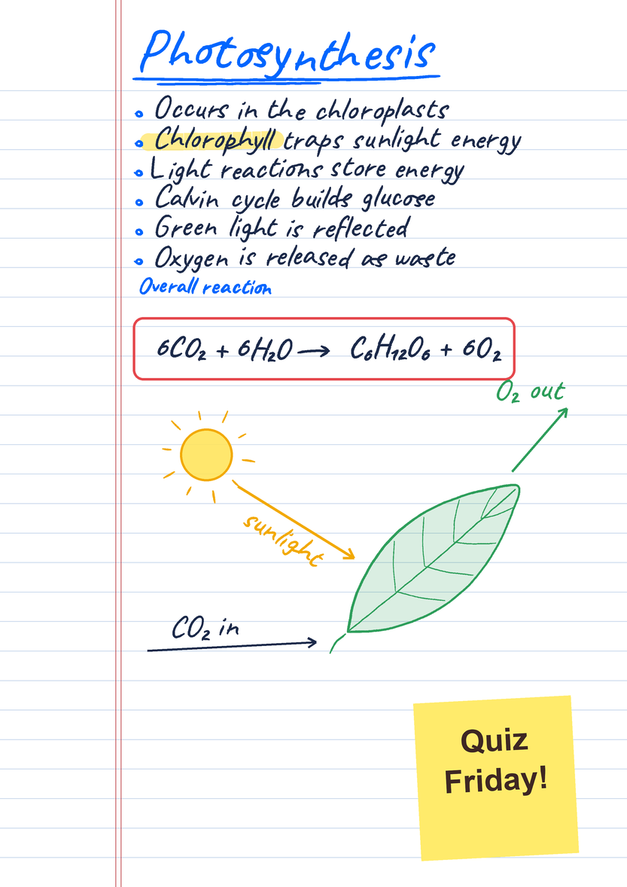
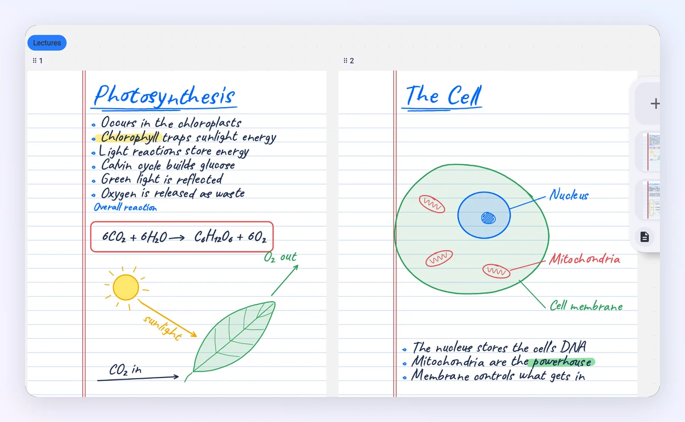
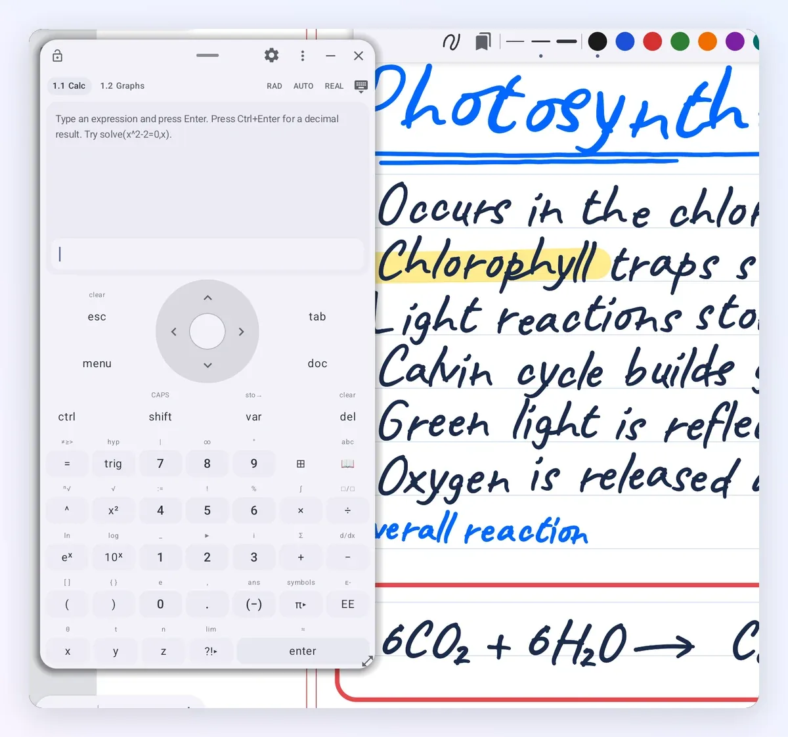
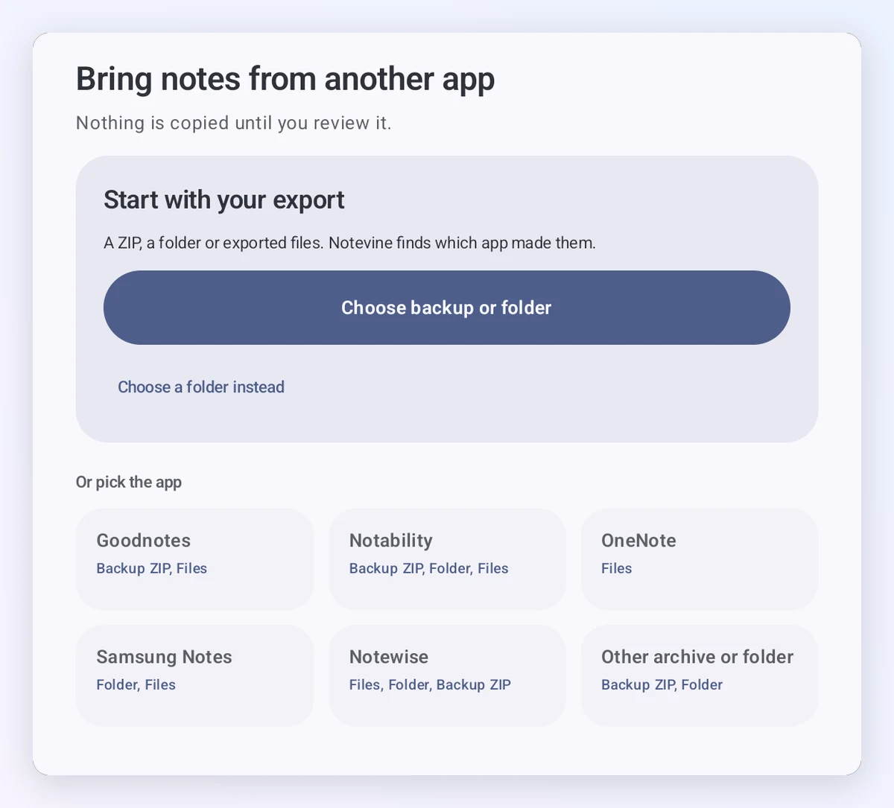

# Notevine

> These are alpha test builds. The public beta starts with beta 0.1.0.

Notevine is a handwriting notebook for Android tablets. Write, draw and annotate with a stylus. Work on separate pages or on one infinite canvas, and switch between them at any time.

## Download

Get the latest version from the [releases page](https://github.com/BBallBoyDaBoss/notevine-releases/releases/latest). Download the `.apk` file under **Assets**.

- Android 12 or newer.
- A 64-bit ARM tablet. Almost every tablet sold since 2019 has one.
- Designed for tablets with a stylus. Finger input is available too.

## Install

1. Open the latest release on your tablet and tap the `.apk` file under **Assets**.
2. If Android blocks the install, tap **Settings** and turn on **Allow from this source**.
3. Go back, then tap **Install**.
4. Open Notevine and follow the four setup screens.

On Samsung tablets, the setting can be under **Settings, Security and privacy, More security settings, Install unknown apps**. If Auto Blocker stops the install, turn it off under **Settings, Security and privacy, Auto Blocker**. Install the app, then turn Auto Blocker on again.

To check the file, compare its SHA-256 checksum with the one in the release notes.

## Updates

Notevine checks for a new version once a day. When there is one, a card shows what changed. Tap **Download now**, then **Install**. To check yourself, open **Settings, Help and about** and tap **Check now**. Notevine checks the file before Android's installer opens. Your notebooks and settings stay.

Install over the old version. Do not uninstall first, because uninstalling deletes Notevine's private storage.

You can turn off the daily check under **Settings, Help and about**. The app reads [releases.json](https://raw.githubusercontent.com/BBallBoyDaBoss/notevine-releases/main/releases.json) from this repository to find new versions.

## Features

Pages suit notes you print or read in order. The infinite canvas suits diagrams and long working sessions. Both views show the same content. Group pages into sections on the canvas, and stack your writing in layers.

You can also add typed text, shapes, pictures and PDF pages.

Record audio while you write. Notevine links each stroke and text box to the moment you made it. Tap any linked writing to hear what was said then.

A calculator opens over your notebook. It solves algebra and calculus, converts units, and keeps results in history.

Place equations and figures from the libraries, or save your own drawings as symbols and reuse them.

Link a Canvas course to a folder or notebook, then open it from there.

Import notes from Goodnotes, Notability, Notewise, Samsung Notes and OneNote.

## Privacy and support

Notevine has no account, no ads and no analytics. Read the [privacy policy](PRIVACY.md) for what leaves the tablet and when.

For installing, backups and moving to a new tablet, read the [support guide](SUPPORT.md).

To report a bug or send an idea, open an [issue](https://github.com/BBallBoyDaBoss/notevine-releases/issues). Reports are public, so leave out private information.
