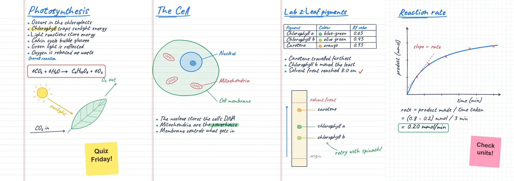
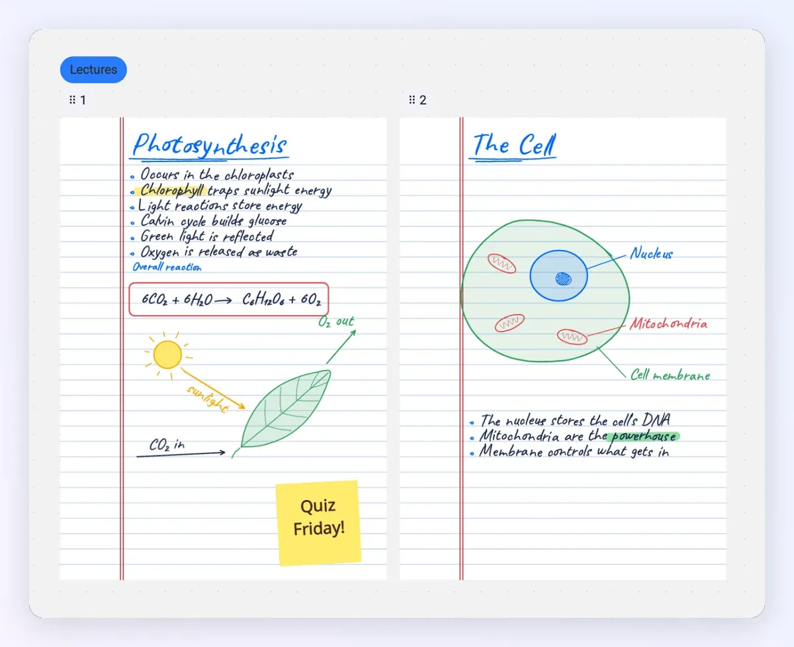
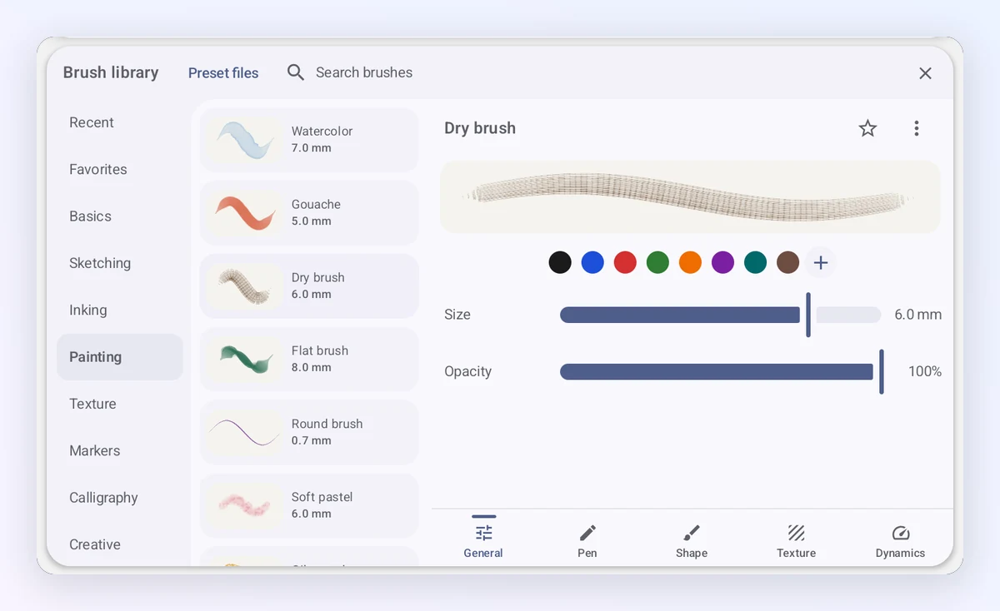
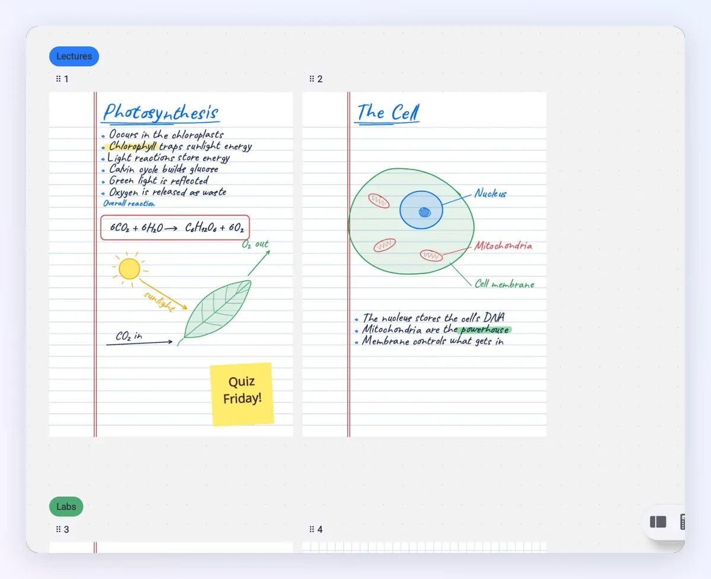
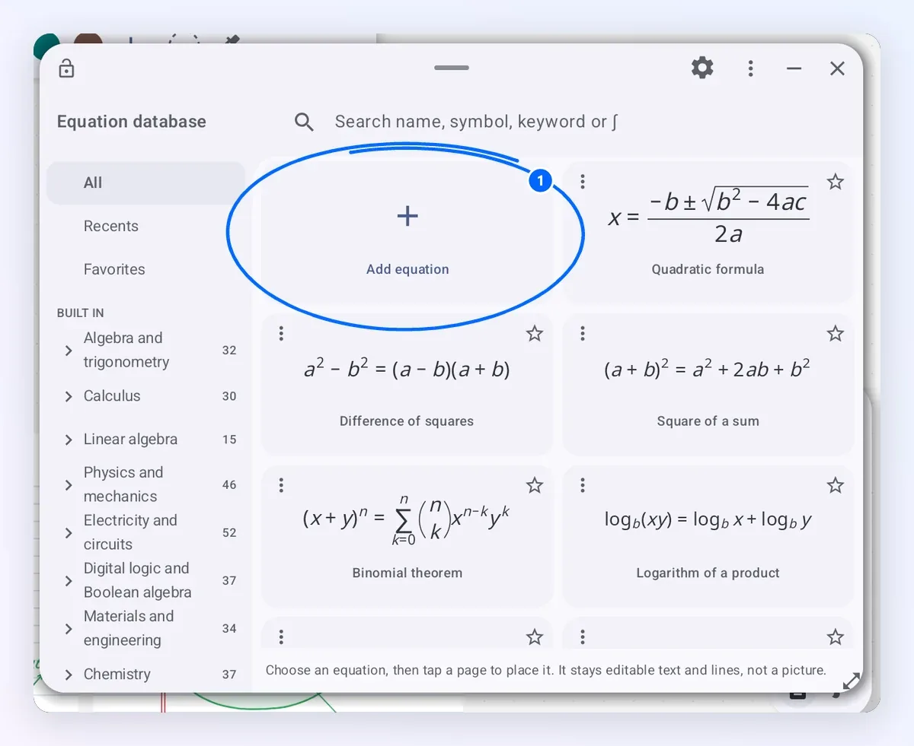
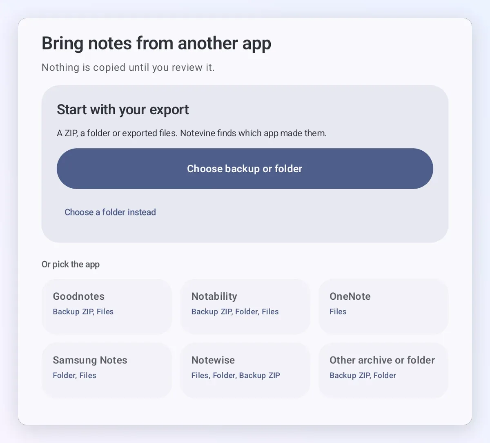
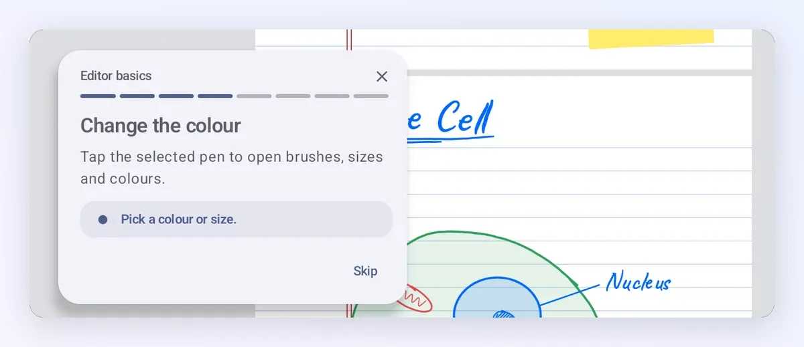

# Notevine

**Handwriting notes for Android tablets. Pages when you want order, one infinite canvas when you want room.**

<a href="https://github.com/BBallBoyDaBoss/notevine-releases/releases/latest"><b>Download the latest APK</b></a>

 

> These are alpha test builds. The public beta starts with beta 0.1.0.
>
> Notevine is free while it's in testing. If it helps you, you can [support it on Ko-fi](https://ko-fi.com/notevine).

## Write by hand, organize like a notebook

<table>
<tr>
<td width="42%" valign="top">

### Pages and an infinite canvas

Work on separate pages, or lay the same pages out on one canvas and zoom between them. Both views show the same notebook, so you can switch at any time.

Group pages into sections on the canvas, then link a page, a section or a notebook from anywhere in your notes.

</td>
<td width="58%">

</td>
</tr>
<tr>
<td width="58%">

</td>
<td width="42%" valign="top">

### Pens and brushes that react to your hand

Choose from a brush library, then tune width, pressure sensitivity and smoothing. Add a highlighter, an eraser, a ruler, shapes, tables, sticky notes and pictures.

</td>
</tr>
<tr>
<td width="42%" valign="top">

### Layers for busy pages

Stack your writing in ink layers. Hide, lock or fade a layer, reorder it, or move a lasso selection onto its own layer.

</td>
<td width="58%">

</td>
</tr>
</table>

## Record a lecture and replay your writing

Turn on **Link to notes** while you record audio. Notevine remembers when you wrote each stroke, text box and shape. Play the recording and your writing traces in as you made it. Tap any linked line to hear what was said at that moment.

## Math tools in the notebook

<table>
<tr>
<td width="50%" valign="top">

### Calculator and graphs

A calculator floats over your notebook, so you can keep writing. It handles exact fractions, algebra, calculus and unit conversion, and keeps a history. Graph several functions, trace points on them, and add the result to your page.

</td>
<td width="50%" valign="top">

### Equation and symbol libraries

Place equations and figures from built-in libraries, or save your own drawings as symbols and reuse them. Placed equations stay editable text and lines, not pictures.

</td>
</tr>
</table>

## Bring your notes with you

<table>
<tr>
<td width="42%" valign="top">

### Import from other apps

Move notebooks in from Goodnotes, Notability, Notewise, Samsung Notes and OneNote. Choose a backup or a folder. Nothing is copied until you confirm.

### Canvas LMS courses

Link a folder or notebook to a Canvas course, then open the course from there. Notevine submits nothing for you.

</td>
<td width="58%">

</td>
</tr>
<tr>
<td width="58%">

</td>
<td width="42%" valign="top">

### Guided tours

Short tours show a tool, then ask you to try it in your own notebook. Each takes about a minute. Open them from Help.

</td>
</tr>
</table>

## Install

1. Open the [latest release](https://github.com/BBallBoyDaBoss/notevine-releases/releases/latest) on your tablet and tap the `.apk` file under **Assets**.
2. If Android blocks the install, tap **Settings** and turn on **Allow from this source**.
3. Go back, then tap **Install**.
4. Open Notevine and follow the four setup screens.

On Samsung tablets, the setting can be under **Settings, Security and privacy, More security settings, Install unknown apps**. If Auto Blocker stops the install, turn it off under **Settings, Security and privacy, Auto Blocker**. Install the app, then turn Auto Blocker on again.

To check the file, compare its SHA-256 checksum with the one in the release notes.

## Updates

Notevine checks for a new version once a day. When one is out, a card shows what changed. Tap **Download now**, then **Install**.

To check yourself, open **Settings, Help and about** and tap **Check now**. Notevine checks the file before Android's installer opens. Your notebooks and settings stay.

Install over the old version. Do not uninstall first, because uninstalling deletes Notevine's private storage.

You can turn off the daily check under **Settings, Help and about**. The app reads [releases.json](https://raw.githubusercontent.com/BBallBoyDaBoss/notevine-releases/main/releases.json) from this repository to find new versions.

## Requirements

- Android 12 or newer.
- A 64-bit ARM tablet.
- A stylus for the best experience. Finger input is available too.

## Privacy and support

Notevine has no account, no ads and no analytics. Read the [privacy policy](PRIVACY.md) for what leaves the tablet and when. For installing, backups and moving to a new tablet, read the [support guide](SUPPORT.md).

## Feedback

To report a bug or send an idea, open an [issue](https://github.com/BBallBoyDaBoss/notevine-releases/issues). Reports are public, so leave out private information.
